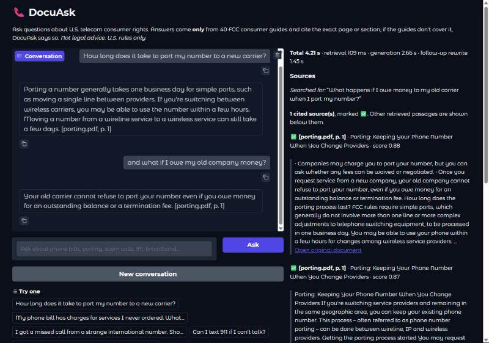
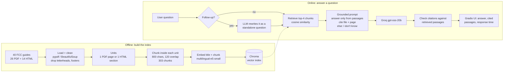

# DocuAsk

[](https://github.com/Abdelrahman2115/docuask/actions/workflows/tests.yml)

A retrieval-augmented generation (RAG) assistant that answers questions about
U.S. telecom consumer rights from 40 FCC consumer guides. Every answer cites
the exact page or section it came from, and when the guides don't cover a
question, DocuAsk says *"I don't know based on the provided documents."*



*A follow-up ("and what if I owe my old company money?") is rewritten into a
standalone question, answered from the porting guide, and cited; the retrieved
passages and response time are shown on the right.*

## The problem

Customer-service questions about phone bills, switching carriers, scam calls
or 911 have precise answers buried in long regulatory guides. A plain chatbot
answers fluently but may invent rules, and gives no way to check. DocuAsk
answers **only** from the documents, shows its sources, and refuses when the
documents are silent - the behaviour a support team would need before trusting
an assistant.

## Results

Measured on a 40-question test set (30 answerable, 10 unanswerable of which 6
are deliberate traps). Retrieval and citation metrics are computed exactly in
code against gold sources; faithfulness and relevancy use RAGAS with an LLM
judge. **Please read the [limitations](#limitations) before quoting these.**

| Metric | Baseline (MiniLM) | Final (e5-small) |
|---|---|---|
| Hit@1 (correct source ranked first) | 0.767 | **0.900** |
| Hit@4 | 0.967 | **1.000** |
| MRR | 0.867 | **0.950** |
| Context precision (ID-based) | 0.850 | **0.914** |
| Answers citing the correct source | 89.7% | **100%** |
| Invented citations | 0 | 0 |
| Unanswerable questions refused | 10/10 | 10/10 |
| Answerable questions wrongly refused | 1/30 | **0/30** |
| RAGAS faithfulness | 0.878 (0.947 after audit*) | **0.978** |
| RAGAS answer relevancy | 0.802 | 0.806 |

\* A manual check found two false zeros from the LLM judge in the baseline run;
the raw score is reported unchanged and the audited value shown for context.

**Interactive latency** (8 questions, laptop CPU, Groq API):
median **1.68 s** end to end, 90th percentile 2.31 s; retrieval median **37 ms**.

### Retrieval experiments

Every row changes one thing from the baseline (the last four combine changes).
Retrieval-only runs need no LLM calls, so all 13 configurations were compared
for free; full generation + RAGAS was run only on the baseline and the winner.

| Experiment | Hit@1 | Hit@4 | MRR | ms/query | Missed |
|---|---|---|---|---|---|
| **baseline**: vector, all-MiniLM-L6-v2, chunk 800 | 0.767 | 0.967 | 0.867 | 14 | a11 |
| chunk 400 | 0.867 | 0.933 | 0.900 | 13 | a02, a11 |
| chunk 1200 | 0.800 | 0.967 | 0.875 | 13 | a11 |
| bge-small-en-v1.5 | 0.867 | 0.967 | 0.917 | 36 | a11 |
| paraphrase-multilingual-MiniLM-L12-v2 | 0.733 | 0.900 | 0.806 | 27 | a09, a11, a19 |
| **multilingual-e5-small** (chosen) | **0.900** | **1.000** | **0.950** | 40 | - |
| BM25 only | 0.833 | 0.967 | 0.900 | 1 | a06 |
| hybrid (MiniLM + BM25, RRF) | 0.867 | 1.000 | 0.928 | 20 | - |
| vector + cross-encoder reranker | 0.900 | 1.000 | 0.944 | 1,048 | - |
| hybrid + reranker | 0.900 | 1.000 | 0.944 | 1,086 | - |
| hybrid + reranker (bge) | 0.900 | 1.000 | 0.944 | 1,040 | - |
| hybrid (e5 + BM25) | 0.867 | 0.967 | 0.917 | 28 | a06 |
| e5 + reranker | 0.900 | 1.000 | 0.944 | 1,729 | - |

What they showed:
- **multilingual-e5-small** was the best single change, and it also supports
  Arabic for the planned upgrade.
- **paraphrase-multilingual-MiniLM got worse**: it reads only 128 tokens, so
  800-character chunks (~180 tokens) were truncated - predicted before the run.
- **Hybrid search** fixed the one keyword-heavy miss ("gift cards"), and BM25
  alone missed a different question - why combining them helps.
- **The cross-encoder reranker** reached the same quality whatever fed it, but
  costs ~1 s per query on CPU, so it lost on the pre-registered rule:
  *highest MRR; configurations within 0.017 (one question moving from rank 1 to
  2) count as tied; ties go to the fastest.*

Full tables: [`data/eval/phase6_retrieval.md`](data/eval/phase6_retrieval.md),
[`data/eval/results_baseline_vs_final.md`](data/eval/results_baseline_vs_final.md).

## Architecture



### Key design decisions

- **Chunks never cross a page or section.** Each PDF page or HTML section is
  split separately, so every chunk has exactly one citation like
  `[porting.pdf, p. 1]` or `[telephone_bill.html, § Cramming]`.
- **800 characters, 120 overlap.** About 180-200 tokens: inside the
  embedding model's input limit and about one topic of an FCC guide.
- **Citations are verified in code.** Every `[file, page]` in an answer is
  checked against the passages actually retrieved; anything else is flagged as
  invented. A fixed refusal sentence makes refusals measurable.
- **Chat history is used only to rewrite follow-ups**, never to answer, so earlier
  turns can't leak unsupported claims into a new answer.
- **The LLM is swappable** (Groq or a local Ollama model) through `config.yaml`.
  When Groq retired the original model from its free tier, the fix was one line.
- **Prompt injection**: the prompt tells the model that passages are reference
  text, not instructions.

## Data

40 consumer guides from the U.S. Federal Communications Commission (26 PDFs,
5 guide web pages, 9 Complaint Center articles) on billing, cramming, slamming,
number porting, robocalls and scams, 911, broadband and complaints. As works of
the U.S. federal government they are public domain, so they are committed in
[`data/raw/`](data/raw) with checksums in `manifest.json`.
`www.fcc.gov` blocks scripted downloads (HTTP 403), so those files were saved
through a browser; `scripts/download_docs.py` fetches the rest and records them.

## How to run

**Requirements:** Python 3.13, a free [Groq API key](https://console.groq.com/keys).

```bash
git clone https://github.com/Abdelrahman2115/docuask.git
cd docuask
python -m venv .venv
# Windows: .venv\Scripts\activate      Linux/macOS: source .venv/bin/activate
pip install -r requirements-dev.txt
pip install -e .
cp .env.example .env              # then put your GROQ_API_KEY in .env

python scripts/ingest.py          # 40 documents -> 303 chunks
python scripts/build_index.py     # embeds chunks into Chroma (first run downloads the model)
python app/app.py                 # http://127.0.0.1:7860
```

Command-line use: `python scripts/ask.py "How long does porting take?"` or
`python scripts/search.py "gift card scam"` (retrieval only).

**Docker:**

```bash
docker build -t docuask .
docker run -p 7860:7860 -e GROQ_API_KEY=your_key docuask
```

The image installs CPU-only PyTorch and builds the index at build time, so the
container starts quickly and needs network access only for the LLM API.
CI builds this image and checks that the app serves its page on every push.

**Tests:** `pytest` (54 tests: cleaning, chunking, citations, retrieval incl.
BM25/RRF/hybrid, the RAG pipeline with a fake LLM, chat history, metrics, and
checks on the real corpus).

**Reproduce the evaluation:**

```bash
pip install -r requirements-eval.txt
python scripts/run_eval.py --name baseline        # answers + code-based metrics
python scripts/ragas_eval.py --name baseline      # RAGAS faithfulness / relevancy
python scripts/run_experiments.py                 # 13 retrieval configurations
python scripts/pick_best.py                       # applies the selection rule
python scripts/benchmark_latency.py               # interactive latency
```

Windows helpers: the `run_phase*.bat` files run each stage and save a log.

**Deployment:** `scripts/deploy_space.py` deploys to a Hugging Face Docker
Space. Since September 2026 Docker/Gradio Spaces on CPU need a PRO plan, and
free container hosts offer about 512 MB of RAM (too little for PyTorch and the
embedding model), so the project ships as a CI-verified Docker image instead.

## Project structure

```
app/app.py                 Gradio UI
src/docuask/
  ingest.py                loading, cleaning, units, chunking
  embeddings.py, index.py  sentence-transformers + Chroma
  retriever.py             vector, BM25, hybrid (RRF), cross-encoder reranking
  prompts.py, rag.py       grounded prompt, pipeline, citation checks
  chat.py                  follow-up rewriting, UI formatting
  evaluation.py, judge.py  metrics, RAGAS judge setup
scripts/                   ingest, index, ask, eval, experiments, benchmark, deploy
data/raw/                  the 40 source documents
data/eval/                 test set, run outputs, result tables
tests/                     54 pytest tests
docs/limitations.md        full list of evaluation caveats
```

## Limitations

Full details and sources in [`docs/limitations.md`](docs/limitations.md). The main ones:

- **The test set is small and was written by the author after reading the
  documents**, which tends to inflate retrieval scores; published work found
  real-user Hit@5 up to 29-37 points lower than on synthetic questions.
  95% confidence intervals are wide (Hit@1 for the final configuration: 0.74-0.97).
- **The configuration was chosen on the same 40 questions** it is scored on, so
  the final numbers are development-set results.
- **The LLM judge is noisy and from the same model family** as the generator
  (gpt-oss-120b judging gpt-oss-20b); part of the faithfulness gain is judge noise.
- **Gold sources are page/section level**, so a "hit" can miss the exact sentence.
- **Only one kind of unanswerable question** (in-domain but not covered).
- **U.S.-only content**, English only; PDF tables are flattened into text.

## Next steps

- A held-out set of short, unedited questions from people who haven't read the
  documents, used once for final numbers.
- A judge from a different model family plus a small human-labelled sample.
- Arabic questions: the chosen embedding model is already multilingual.
- More unanswerable types (false premise, underspecified) and an optional
  score threshold to refuse before calling the LLM.
- Streaming answers and a reranker when a GPU is available.

## Tech stack

Python 3.13 · LangChain (text splitter, LLM interface) · sentence-transformers ·
Chroma · rank-bm25 · Groq (`openai/gpt-oss-20b`) · RAGAS 0.4 · Gradio 6 ·
Docker · GitHub Actions
